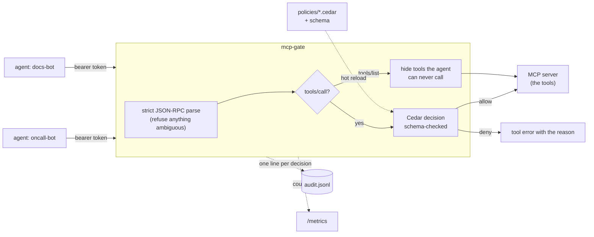

# mcp-gate

A policy gate for AI agents' tool calls. Agents connect to `mcp-gate` instead of straight to an MCP server; every `tools/call` is checked against policies written in [Cedar](https://www.cedarpolicy.com/) before it reaches the tool.

```text
Denied by mcp-gate (policy never-scale-prod-to-zero): Scaling a prod deployment to zero replicas takes the service down.
```

Go 1.27 · official MCP Go SDK · cedar-go · Prometheus · native fuzzing. Personal learning project, built pairing with Claude Code. The "Kubernetes" behind it is a fake in-memory cluster.

## What it does



- **Who:** agents authenticate with bearer tokens; the config stores only their SHA-256 hashes.
- **What they may do:** Cedar policies over agent, tool, arguments and time. Default deny; a `forbid` always wins.
- **Type-checked rules:** policies and every request are checked against a Cedar schema. A typo in a policy fails to load; an unexpected argument is denied.
- **Hard to fool:** duplicate keys, case-folded keys (`Method`, `argumentſ`), header/body mismatches and batches are refused before any decision.
- **Safe to change:** policy files hot-reload; a broken edit is rejected and the last good set stays in force. `mcp-gate test` runs policy test cases like unit tests.

## Try it

```bash
go build -o bin/ ./cmd/...
./bin/demo-server                          # the fake cluster's MCP server on :8090
./bin/mcp-gate serve -config gate.yaml     # the gate on :8081, metrics on :9091
./bin/agent -token demo-docs-token tools
./bin/agent -token demo-oncall-token call scale_deployment '{"namespace":"prod-payments","deployment":"api","replicas":0}'
./bin/mcp-gate test  -config gate.yaml     # the policy test cases
./bin/mcp-gate check -config gate.yaml     # who can see which tools
go test ./...
```

## The rules in this demo

| Policy | Effect |
|---|---|
| `read-tools-for-every-agent` | permit any agent the `read` tools |
| `sre-changes-outside-prod` | permit SRE agents `write` tools outside `prod-*` |
| `prod-changes-need-on-call` | permit SRE agents `write` tools in prod only if `on_call` |
| `never-scale-prod-to-zero` | forbid `scale_deployment` to 0 in prod |
| `replica-cap` | forbid scaling above 20 |
| `weekend-prod-freeze` | forbid prod writes on Saturday and Sunday (gate's time zone) |
| `no-destructive-tools` | forbid the `destructive` group (`delete_namespace`) |

## What it doesn't protect against

- **A reachable tool server.** If agents can reach the MCP server directly, nothing here applies. The server must only be reachable from the gate.
- **Allowed but harmful calls.** Policies limit what's possible; they don't judge intent. An on-call agent can still restart the wrong deployment.
- **What tools return.** The gate checks requests, not results. A tool reply carrying a prompt injection or a secret passes through.
- **Methods it can't check.** `resources/*`, `prompts/*` and `tasks/*` are refused by default. Listing them in `extra_methods` passes them through unchecked.
- **Stolen tokens.** Tokens are static bearer tokens. A real deployment would use OAuth (MCP's authorization spec) or mTLS.

## Project layout

| Path | What |
|---|---|
| `cmd/mcp-gate` | the gate: `serve`, `test`, `check`, `hash-token` |
| `cmd/demo-server` | the fake cluster's MCP server |
| `cmd/agent` | a small MCP client that plays the agent |
| `internal/gate` | HTTP handling, strict parsing, SSE filter, metrics |
| `internal/authz` | Cedar engine, schema checks, hot-reload store |
| `internal/policytest` | policy test runner |
| `internal/config`, `internal/audit`, `internal/demo` | config, audit log, fake cluster |
| `policies/` | `schema.cedarschema`, the `.cedar` policies, `tests.yaml` |
| `scripts/smoke.sh` | starts the real binaries and checks nine answers |
| `LEARN.md` | the ideas behind it, questions to answer without notes, exercises |

## Build log

### Step 1: a demo MCP server to protect

`internal/demo` is a fake Kubernetes cluster behind five MCP tools, built on the official Go SDK (`github.com/modelcontextprotocol/go-sdk` v1.8.0): `list_pods`, `get_logs`, `restart_deployment`, `scale_deployment`, `delete_namespace`. It runs in memory and touches no real cluster.

The test connects a real SDK client four ways: the newest protocol (2026-07-28, stateless, `server/discover`) and the last session-based one (2025-11-25), each with JSON replies and with SSE replies. The gate has to handle all four, so it needs a server that can produce all four.

What broke: the first run hung for 10 minutes. The test closed the HTTP test server while the client's standalone SSE stream (a long-lived GET) was still open, and `httptest.Server.Close` waits for every connection. Fixed by registering cleanups so the session closes first.

### Step 2: Cedar policies and the decision engine

`internal/authz` turns a tool call into a Cedar request and decides it, using `github.com/cedar-policy/cedar-go` v1.9.2:

| Cedar part | What it is here |
|---|---|
| principal | `Agent::"oncall-bot"`, a member of `Team::"sre"`, with an `on_call` attribute |
| action | one per tool (`Action::"scale_deployment"`), each in a risk group: `read`, `write`, `destructive` |
| resource | the upstream server, `Server::"k8s"` |
| context | the call's arguments as `context.args`, plus `context.clock` (hour and weekday in the gate's time zone) |

The policies live in `policies/`: every agent may read; SRE agents may change things outside prod; in prod only an on-call agent may; never scale prod to zero; never above 20 replicas; no prod changes at weekends; destructive tools never. Each policy has an `@id` and a `@reason`, and a denied agent is told the reason.

Choices worth explaining:
- **Risk groups come from the gate's schema, not the server.** MCP tools can describe themselves as read-only or destructive, but those are hints from the server being protected. The gate ignores them.
- **Everything is type-checked against `policies/schema.cedarschema`.** A policy that reads `context.args.namespce` (typo) fails to load. A call whose arguments don't match the tool's declaration (an extra `force: true`, `replicas: "3"` as a string, a missing argument) is denied before any policy runs.
- **Fail closed on evaluation errors.** Cedar skips a policy that errors. If that policy were a forbid, the call could get through, so the gate denies any call where a policy errored.
- **`tools/list` visibility** uses a second, scope-only copy of the policies: permits with their conditions removed, and only the forbids that have no conditions. A tool is listed if some permit could ever apply. It's a convenience for the model; the real check runs on every call.
- **No argument values in reasons.** Cedar's validation error quotes the arguments. Those could hold secrets, so the gate's reason says what the schema expects instead.

Tests: 20 decision cases (each checks allow/deny and *which* policies decided), visibility per agent, and five ways a bad policy file must fail to load (typo, an attribute some tools in a group lack, an unknown action, a syntax error, a duplicate ID).

### Step 3: the gate

`internal/gate` is an `http.Handler` in front of the upstream MCP server (Streamable HTTP). For every request it:

1. **Authenticates the agent** from `Authorization: Bearer …`. The config stores only SHA-256 hashes of tokens. The agent's token is removed before forwarding, so the tool server never sees it.
2. **Parses the JSON-RPC message strictly** (Go 1.27's `encoding/json/v2` and `jsontext`) and refuses anything two parsers could read differently:

   | Trick | Why it matters | Gate's answer |
   |---|---|---|
   | `"name"` twice in one object | gate reads one, server reads the other | 400 (RFC 7493: names must be unique) |
   | `"Method"` or `"Name"` instead of the lowercase key | Go's `encoding/json` v1 matches keys case-insensitively | 400 |
   | `"argumentſ"` (long s) | v1's case folding turns ſ into s | 400 |
   | `Mcp-Name: list_pods` header, `delete_namespace` in the body | MCP 2026-07-28 copies method and tool name into headers so proxies can route on them | 400 if they disagree |
   | JSON-RPC batch | every element would need its own decision; MCP dropped batches in 2025-06-18 | 400 |
   | invalid UTF-8, oversized body | | 400, 413 |

   The upstream then receives exactly the bytes the gate checked.
3. **Decides `tools/call`** with the Step 2 engine. A denial goes back to the agent as a normal tool result with `isError: true`, e.g. `Denied by mcp-gate (policy never-scale-prod-to-zero): Scaling a prod deployment to zero replicas takes the service down.` That's how MCP reports tool failures, so the model can read it and change course.
4. **Refuses methods it can't check**: `resources/*`, `prompts/*` and `tasks/*` are refused unless the operator lists them. Lifecycle methods, `tools/list` and notifications pass through.
5. **Filters `tools/list` replies**, both plain JSON and SSE streams, and also GET streams, because a client resuming a dropped stream can get an old `tools/list` reply replayed there. The SSE filter rewrites one event at a time, so long-lived streams aren't held back.
6. **Audits and counts**: one JSON line per decision (agent, tool, decision, deciding policies, argument *names* only), plus Prometheus counters with label values taken only from the config and schema.

Tests (24, all on real SDK clients or raw HTTP, no mocks of the gate):
- three agents through the gate in all four protocol/transport combinations: what each sees in `tools/list`, which calls pass, and that denied calls leave the fake cluster unchanged
- each trick in the table above, plus the check that it never reached the upstream
- an unknown token, the upstream being down (502, audited), the filter on edge cases, and the SSE filter's streaming behaviour

What broke: nothing in the tests on the first full run. `go vet` first failed because `go mod tidy` in Step 1 had dropped modules that later code needed.

### Step 4: a program you can run

- `cmd/mcp-gate`: `serve`, `test`, `check`, `hash-token`. Agents connect on `127.0.0.1:8081/mcp`; `/metrics` and `/healthz` are on a separate admin port (`127.0.0.1:9091`) that agents aren't given.
- `gate.yaml`: strict YAML (a misspelt key is an error), agents listed with token *hashes*.
- **Hot reload** (`authz.Store`): the policy folder is polled every 2 s. A good change is swapped in atomically. A change that doesn't parse or type-check is logged, counted (`mcpgate_policy_reloads_total{result="failed"}`) and ignored: the gate keeps enforcing the previous set. Polling, not file events, because it behaves the same on Windows, Linux and a Kubernetes ConfigMap mount.
- **Policy tests** (`policies/tests.yaml`, run with `mcp-gate test`): 14 cases written for people, each naming the agent, tool, arguments, time, expected decision and, where it matters, the policy that must decide it and whether the tool is visible. One checks that 23:30 on a Friday in India is still a weekday for the weekend freeze, though it's Friday 18:00 in UTC.
- `cmd/agent`: a small MCP client that plays the agent, for trying the gate by hand.

Run on this laptop with the real binaries (`demo-server`, `mcp-gate serve`, then `agent`):

| Agent | Call | Result |
|---|---|---|
| docs-bot | `tools` | sees `get_logs`, `list_pods` only |
| docs-bot | `scale_deployment` staging | `Denied by mcp-gate: no policy permits agent "docs-bot" … (default deny)` |
| oncall-bot | `scale_deployment` prod-payments to 5 | `scaled prod-payments/api from 3 to 5` |
| oncall-bot | `scale_deployment` prod-payments to 0 | `Denied by mcp-gate (policy never-scale-prod-to-zero): …` |
| oncall-bot | `delete_namespace` | `Denied by mcp-gate (policy no-destructive-tools): …` |
| docs-bot, protocol 2025-11-25 | `list_pods` | works (shows the 5 pods from the scale above) |
| wrong token | `tools` | `Unauthorized` |

Then, with the gate still running: adding a policy file let docs-bot restart a dev deployment within 2 s; breaking that file (`namespce`) was rejected with the typo named and the previous rules kept working; deleting the file took the permission away again.

The same run showed the gap the gate can't close by itself: the demo server answered `agent` directly on port 8090 with no token. In a real deployment the tool server must only be reachable from the gate (a network policy, or binding it to the gate's private network).

Tests added: policy store reload (good edit, broken edit kept out, same broken file not retried), config validation (7 bad configs), and the shipped policy cases. What broke: nothing; `gofmt` reflowed two files.

### Step 5: fuzzing and benchmarks

Three fuzz targets (Go's built-in coverage-guided fuzzing), each stating a property rather than "doesn't crash":

| Target | Property | Run on this laptop |
|---|---|---|
| `FuzzParseAgreesWithLenientParser` | whatever the gate accepts, Go's lenient `encoding/json` v1 (case-insensitive, last duplicate wins) reads the same method, tool and arguments | 746,631 inputs in 2 min, no disagreement |
| `FuzzSSEPassthrough` | with an identity rewrite, a spec-exact SSE parser reads the same events before and after the filter | **failed in 40 s**, fixed, then 1,814,656 inputs in 2 min, clean |
| `FuzzAuthorizeCall` | arbitrary argument JSON never panics, and anything allowed has exactly the declared shape with replicas in 0–20 | **failed on a seed**, fixed, then 1,895,251 inputs in 2 min, clean |

What the fuzzers found (both fixed, both now regular test cases):
1. **Null arguments slipped past the schema.** `{"…","extra": null}` was allowed: the engine dropped nulls (Cedar has no null) before the schema check, while the tool still received `extra`. Now a null is accepted only for an argument the schema declares optional; anything else is denied.
2. **The SSE filter split lines only on LF.** The SSE spec also ends a line at CRLF and at a lone CR, so for input like `data:\r\r\n\n` the gate and a client saw different events: the same kind of disagreement the strict parser exists to prevent. The filter now splits lines exactly as the spec does, and treats a bare `data` line (no colon) as empty data.

Benchmarks (`go test -bench . -count 3`, Intel i5-10310U laptop on Windows, in-process HTTP over loopback; numbers are noisy, ranges are the three runs):

| What | Time |
|---|---|
| Cedar decision, read tool allowed | 8.0–9.0 µs |
| Cedar decision, write tool allowed / denied by a forbid | 11.4–16.7 µs |
| Denied by the schema (bad argument type) | 19.2–19.7 µs |
| `tools/list` visibility check, per tool | 1.9–2.1 µs |
| One `tools/call`, JSON reply: direct / through the gate | 0.94–1.18 ms / 1.78–2.37 ms |
| One `tools/call`, SSE reply: direct / through the gate | 1.26–1.73 ms / 1.59–2.54 ms |

So the gate adds roughly 0.5–1 ms per call here, and the policy decision is about 1% of that; the rest is the second HTTP hop and parsing. Next to a model call that takes seconds, it doesn't matter. What these numbers don't show: behaviour under many concurrent agents, or over a real network.

### Step 6: smoke test, CI workflow, learning notes

- `scripts/smoke.sh` builds the binaries, starts the demo server and the gate as separate processes, and checks nine answers through `agent`, `/metrics` and the audit log. It passes on this laptop (Git Bash on Windows).
- `.github/workflows/ci.yml`: gofmt, vet, tests with the race detector, the policy cases, 30 s per fuzz target, and the smoke test. **It has not run**: the project isn't published. The race detector needs cgo, which this laptop doesn't have, so `-race` has only been specified, not tried.
- `LEARN.md`: MCP, Cedar and the Go features used, the security ideas, 12 questions to answer without notes, and 4 exercises.

Where it stands: 6 local commits, every test passing (`go test ./...`), 14/14 policy cases, smoke test passing. Not published.
